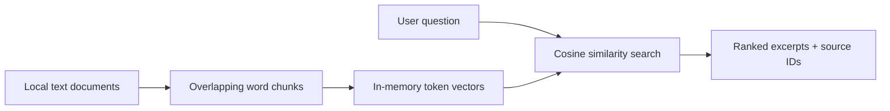

# Enterprise RAG Assistant

**.NET 10 / C# · local document retrieval · optional Azure OpenAI grounded answers**

A progressively built enterprise retrieval-augmented generation portfolio project. The default mode is offline lexical retrieval. An optional Azure OpenAI mode generates answers from retrieved excerpts.

## Architecture



## Run locally

Install .NET 10 SDK, then from the repository root:

```bash
dotnet run --project src/EnterpriseRag -- ask "How should latency incidents be handled?"
dotnet test tests/EnterpriseRag.Tests/EnterpriseRag.Tests.csproj
```

Provide additional UTF-8 text documents as arguments after the question. The default example is `samples/operations.txt`.

## Optional AI mode

Configure Azure OpenAI credentials as described in [the setup guide](docs/azure-openai.md), then run:

```bash
dotnet run --project src/EnterpriseRag -- ask "How should latency incidents be handled?" --ai
```

The AI mode may incur Azure usage charges. It is disabled by default.

## Semantic search (optional)

With an Azure OpenAI embedding deployment configured, use `--semantic` to rank document chunks by neural embedding similarity instead of lexical overlap. Combine `--semantic --ai` for generated answers from semantic search results. See [semantic search setup](docs/semantic-search.md).

```bash
dotnet run --project src/EnterpriseRag -- ask "How do we address processing delays?" --semantic
```

## What is implemented

- Plain-text ingestion and overlapping word chunking
- Deterministic normalized token-frequency vectors and cosine similarity
- Top-K ranked excerpts with document and chunk references
- Abstention when no query tokens overlap
- Automated unit tests and GitHub Actions CI

## Limitations and roadmap

Token-frequency vectors are a local baseline, not neural embeddings. The default mode returns cited excerpts; the optional Azure OpenAI mode generates answers from retrieved context, but citations and grounding are not independently verified. Retrieval is in-memory, there is no tenant-level authorization, and lexical overlap is not evidence of semantic correctness.

Next: vector index abstraction and Azure AI Search; PDF ingestion; retrieval evaluation, security, observability and deployment. Azure integrations will remain opt-in.
