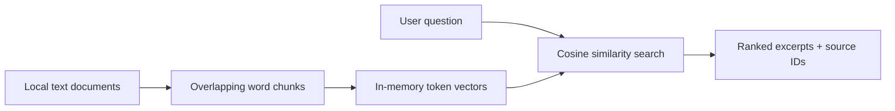

# Enterprise RAG Assistant

**.NET 10 / C# · local document retrieval · optional Azure OpenAI grounded answers**

A progressively built enterprise retrieval-augmented generation portfolio project. The default mode is offline lexical retrieval. An optional Azure OpenAI mode generates answers from retrieved excerpts.

## Architecture



## Run locally

Install .NET 10 SDK, then from the repository root:

```bash
dotnet run --project src/EnterpriseRag -- ask "How should latency incidents be handled?"
dotnet test tests/EnterpriseRag.Tests/EnterpriseRag.Tests.csproj
```

Provide additional UTF-8 text documents as arguments after the question. The default example is `samples/operations.txt`.

## Optional AI mode

Configure Azure OpenAI credentials as described in [the setup guide](docs/azure-openai.md), then run:

```bash
dotnet run --project src/EnterpriseRag -- ask "How should latency incidents be handled?" --ai
```

The AI mode may incur Azure usage charges. It is disabled by default.

## Semantic search (optional)

With an Azure OpenAI embedding deployment configured, use `--semantic` to rank document chunks by neural embedding similarity instead of lexical overlap. Combine `--semantic --ai` for generated answers from semantic search results. See [semantic search setup](docs/semantic-search.md).

```bash
dotnet run --project src/EnterpriseRag -- ask "How do we address processing delays?" --semantic
```

## Persistent local vector index

Index document embeddings once and reuse them for later searches. See [vector index commands](docs/vector-index.md) for setup and CLI examples. This local JSON-backed index is a prototype, not Azure AI Search.

## Azure AI Search (optional)

Use `--azure-search` with the `index`, `search`, or `delete` commands to select a cloud-hosted vector index. The Azure AI Search index schema must be provisioned first. See [Azure AI Search setup](docs/azure-ai-search.md). The local JSON index remains the default.

## PDF ingestion and retrieval evaluation

Text-based PDFs and UTF-8 text documents can now be read by the same ingestion pipeline. Run a deterministic retrieval accuracy@1 check with `dotnet run --project src/EnterpriseRag -- eval evals/cases.json samples/operations.txt`. See [PDF and evaluation guide](docs/pdf-ingestion-and-evals.md). Scanned PDFs require OCR, which is not included.

## Reliability and telemetry

Cloud adapters now use bounded retries for transient HTTP failures and emit ActivitySource/Meter telemetry without recording prompt text or API keys. See [operations and security notes](docs/operations.md).

## Microsoft Entra ID (optional)

Set `AZURE_AUTH_MODE=entra` to use DefaultAzureCredential for Azure OpenAI and Azure AI Search instead of API keys. Configure the required Azure RBAC roles; see [Entra ID authentication](docs/entra-auth.md). API-key mode remains the default.

## Docker demo (no Azure credentials)

```bash
docker build -t enterprise-rag-assistant:local .
docker run --rm enterprise-rag-assistant:local ask "How should latency incidents be handled?"
docker run --rm enterprise-rag-assistant:local eval evals/cases.json samples/operations.txt
```

See [Docker demo instructions](docs/docker-demo.md) for running with your own documents. The image is a CLI, not an HTTP service.

## HTTP API (offline demo)

Run `dotnet run --project src/EnterpriseRag.Api --urls http://localhost:5080` for `/health`, `/documents` and `/ask` endpoints. See [HTTP API guide](docs/http-api.md). A separate `Dockerfile.api` packages the web service without changing the CLI container.

## Azure-backed HTTP API (optional)

Set `RAG_BACKEND=azure` to connect the API to Azure OpenAI embeddings, Azure AI Search, and grounded answer generation. See [cloud API setup](docs/cloud-api.md). The default API remains offline and credential-free.

## API authentication and tenant isolation

In Azure-backed API mode, requests require a validated Microsoft Entra ID access token and are routed to a tenant-specific Azure AI Search index. Configure `AZURE_TENANT_ID` and `AZURE_API_AUDIENCE` and provision tenant indexes; see [API security](docs/api-security.md). Offline demo mode remains unauthenticated and is not suitable for public exposure.

## What is implemented

- Plain-text ingestion and overlapping word chunking
- Deterministic normalized token-frequency vectors and cosine similarity
- Top-K ranked excerpts with document and chunk references
- Abstention when no query tokens overlap
- Automated unit tests and GitHub Actions CI

## Limitations and roadmap

Token-frequency vectors are a local baseline, not neural embeddings. The default mode returns cited excerpts; the optional Azure OpenAI mode generates answers from retrieved context, but citations and grounding are not independently verified. Retrieval is in-memory, there is no tenant-level authorization, and lexical overlap is not evidence of semantic correctness.

Next: vector index abstraction and Azure AI Search; PDF ingestion; retrieval evaluation, security, observability and deployment. Azure integrations will remain opt-in.
