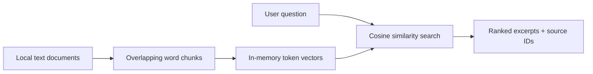

# Enterprise RAG Assistant

**.NET 10 / C# · local document retrieval · source-attributed results**

A progressively built enterprise retrieval-augmented generation portfolio project. This first milestone provides an offline **retrieval foundation**, not a generative language model.

## Architecture



## Run locally

Install .NET 10 SDK, then from the repository root:

```bash
dotnet run --project src/EnterpriseRag -- ask "How should latency incidents be handled?"
dotnet test tests/EnterpriseRag.Tests/EnterpriseRag.Tests.csproj
```

Provide additional UTF-8 text documents as arguments after the question. The default example is `samples/operations.txt`.

## What is implemented

- Plain-text ingestion and overlapping word chunking
- Deterministic normalized token-frequency vectors and cosine similarity
- Top-K ranked excerpts with document and chunk references
- Abstention when no query tokens overlap
- Automated unit tests and GitHub Actions CI

## Limitations and roadmap

**This is not yet a full RAG assistant.** Token-frequency vectors are a local baseline, not neural embeddings; answers are cited excerpts, not generated synthesis. Retrieval is in-memory, there is no tenant-level authorization, and lexical overlap is not evidence of semantic correctness.

Next: optional Azure OpenAI embeddings and grounded answer generation; vector index abstraction and Azure AI Search; PDF ingestion; retrieval evaluation, security, observability and deployment. Azure integrations will remain opt-in.
