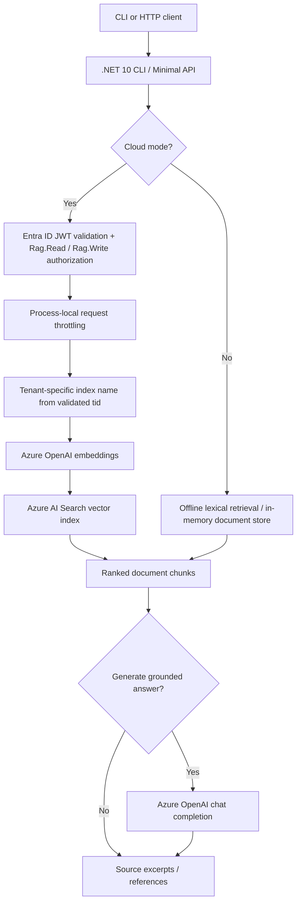
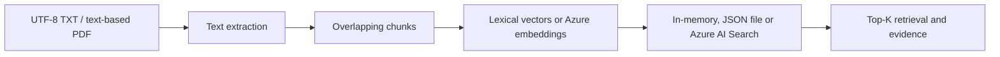
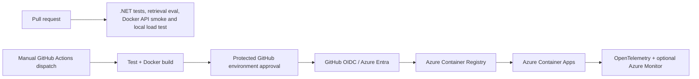

# Enterprise RAG Assistant — Architecture and design decisions

## End-to-end request flow

## Ingestion flow

## Operations and delivery

## Key engineering decisions

| Decision | Rationale | Trade-off |
|---|---|---|
| Offline-first lexical baseline | Deterministic, zero-credential development and CI | Lexical similarity misses paraphrases |
| Optional neural embeddings and Azure AI Search | Scalable semantic retrieval | Azure provisioning, cost, network dependencies |
| Separate CLI and Minimal API | Reuse core retrieval and keep simple demo path | Two packaging/deployment entry points |
| Tenant-derived search indexes | Prevent cross-tenant retrieval through a shared index | Index provisioning and lifecycle per tenant |
| Entra JWT + scopes/app roles | Require validated identity and explicit read/write grants | No per-user document ACLs |
| Bounded retries | Tolerate transient 429/5xx and network failures | Must avoid retry amplification; no end-to-end chaos test |
| Process-local throttling | Lightweight abuse protection | Not a distributed quota |
| Manual OIDC deployment | No long-lived Azure credentials or automatic billable deployment | Requires environment configuration and approvals |

## Security boundaries

The offline API is intentionally unauthenticated: **do not expose it to the internet**. Cloud mode validates a single configured Entra tenant, audience, and token signature; applies read/write permissions; and derives the Azure AI Search index from the validated tenant claim. Managed identities and RBAC protect Azure service calls. For real production use, add gateway/WAF, network isolation review, per-document ACLs, audit trails, distributed rate limiting, secure secrets/configuration lifecycle and threat modeling.

## Observability and test evidence

OpenTelemetry instrumentation includes API request counts, failure counts, latency, and outbound cloud activity. Optional Azure Monitor resources are declared in Bicep. Automated tests cover the local document lifecycle, cloud HTTP retry/cancellation behavior, and a bounded localhost API load smoke test. **No live Azure production availability, load, or retrieval-quality metrics are claimed.**

See [testing and resilience](testing-and-resilience.md), [observability](observability.md), [API security](api-security.md), and [Azure CI/CD](azure-cicd.md).
